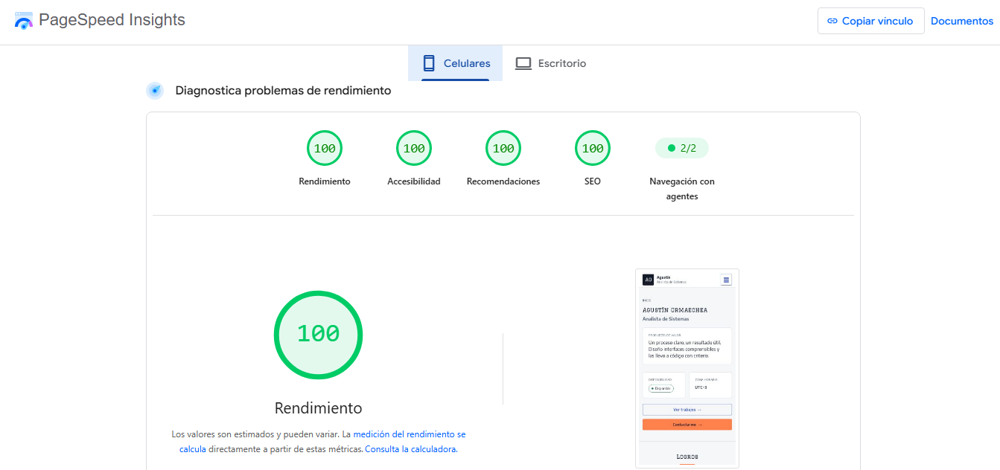
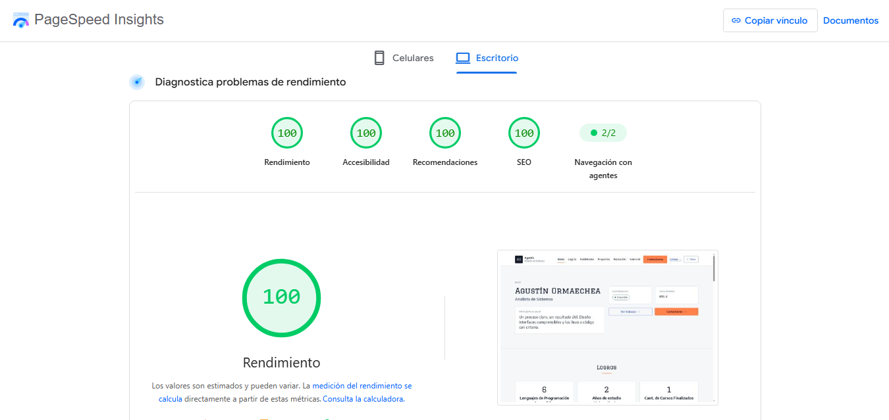
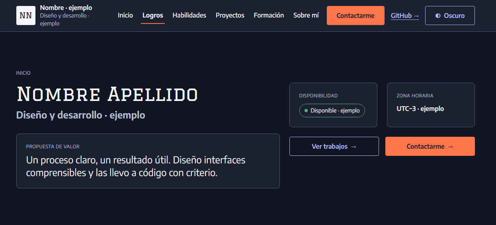
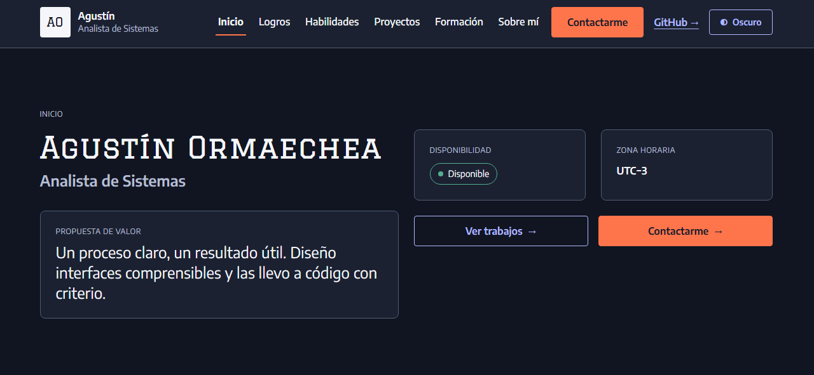
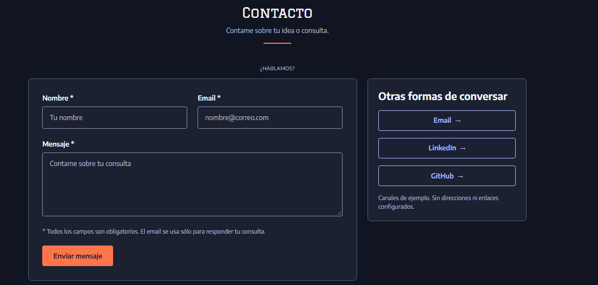
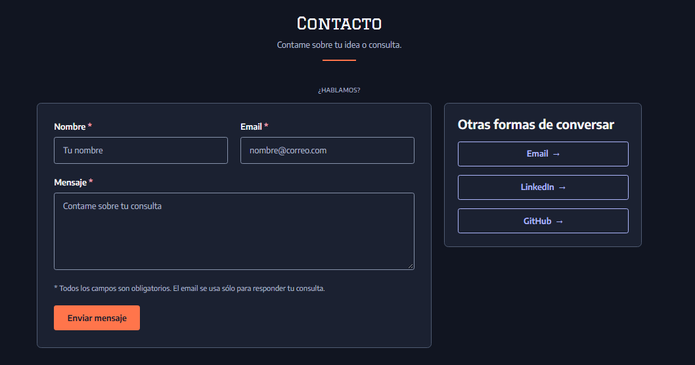

# Portfolio UX/UI — Trabajo Final

Portfolio personal estático desarrollado como trabajo final de **Diseño UX/UI** (Licenciatura en Sistemas de Información, 2026).

## 🔗 Links Principales

- **Sitio desplegado (GitHub Pages):** [https://agustinorm.github.io/TP_F_UX-UI_2026/](https://agustinorm.github.io/TP_F_UX-UI_2026/)
- **Repositorio:** [https://github.com/AgustinOrm/TP_F_UX-UI_2026](https://github.com/AgustinOrm/TP_F_UX-UI_2026)
- **Prototipo de Alta Fidelidad (Figma Make):** [Ver prototipo interactivo](https://www.figma.com/make/qXo3UyHkZWa73wfqf09veL/Prototipo_Alta_Fidelidad_Tp_Final.?fullscreen=1&t=qAS8PrL21kQnu3lX-1&code-node-id=0-6)
- **Design System, Wireframes y Sitemap (Figma):** 
  - [Design System](https://www.figma.com/design/jKGpM6PPleU07xtOzlMaSb/Design_System_Tp_Final.?m=auto&t=C3Jr94S3vUk7BxLd-1)
  - [Wireframes](https://www.figma.com/design/V6GlDGbKH3FGhwdBjMhcxN/WireFrame_Tp_Final.?m=auto&t=C3Jr94S3vUk7BxLd-1)
  - [Sitemap y Card Sorting](https://www.figma.com/design/3X7djJ0AqreZztPvx5YcdE/Sitemap-y-Card-Sorting_Tp_Final.?m=auto&t=C3Jr94S3vUk7BxLd-1)

## 🧱 Stack y Tecnologías

- **HTML5 semántico** (`header`, `nav`, `main`, `section`, `article`, `footer`).
- **CSS3 puro** con variables personalizadas (`:root`), Flexbox y CSS Grid.
- **JavaScript vanilla** (sin frameworks) para el toggle de tema, menú hamburguesa, validación de formulario y envío AJAX.
- **Google Fonts:** *Encode Sans* + *Graduate* (2 familias, `font-display: swap`).
- **Formspree:** Integración para el envío real del formulario de contacto sin backend.
- **GitHub Pages:** Hosting estático para el despliegue.

*Sin React, Vue, Next.js, Wix, Webflow ni constructores visuales.*

## ⚡ Performance y Lighthouse

Se realizaron pruebas de rendimiento, accesibilidad y SEO utilizando PageSpeed Insights (Lighthouse) en modo Mobile y Desktop, obteniendo un puntaje de 100/100 en todas las métricas principales gracias a la optimización de imágenes y la ausencia de librerías pesadas.

**Captura Mobile:**


**Captura Desktop:**


## 📸 Comparación Figma vs. Sitio Desplegado

Fidelidad de implementación entre el diseño prototipado y el código final:

| Sección | Figma (Prototipo) | Sitio Desplegado (HTML/CSS) |
| :--- | :--- | :--- |
| **Inicio** |  |  |
| **Contacto** |  |  |

## 🤖 Uso de IA

Este proyecto fue desarrollado con asistencia de Inteligencia Artificial para:

- Traducción del prototipo de Figma a HTML y CSS puro.
- Refactorización del CSS en múltiples archivos para mantener el código limpio.
- Implementación de la lógica de validación en JavaScript y la integración con la API de Formspree.
- Redacción y estructuración de la documentación.

Todo el código generado fue revisado, testeado y ajustado manualmente por el alumno para asegurar que cumpla con los estándares de accesibilidad, responsive design y las consignas específicas del trabajo práctico.

## 📄 Créditos

- Tipografías: [Google Fonts](https://fonts.google.com/) (Encode Sans y Graduate).
- Procesamiento de formulario: [Formspree](https://formspree.io/).
- Imágenes optimizadas con [Squoosh](https://squoosh.app/).

## 📁 Estructura del Proyecto

```text
/
├── index.html                  # Página principal (One-page)
├── proyecto-openart.html       # Página interna del caso de estudio
├── 404.html                    # Página de error personalizada
├── css/
│   ├── styles.css              # Design System base y variables globales
│   ├── index.css               # Estilos específicos del index
│   ├── openart.css             # Estilos específicos del caso de estudio
│   └── 404.css                 # Estilos específicos del error
├── js/
│   └── main.js                 # Lógica de interacciones y validación
├── assets/                     # Imágenes optimizadas (.avif) y capturas
└── README.md

